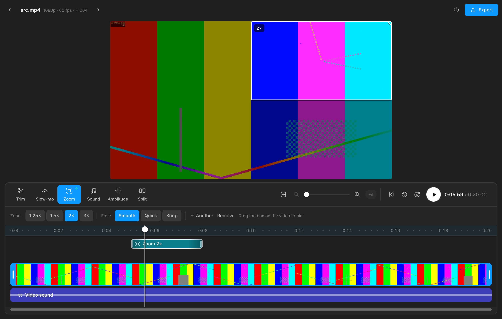

# QuickCut

A small, fast Windows video editor for clips: trim, split, slow motion, zoom, sound effects and volume. Trims and splits keep your original quality bit for bit.

**[Download for Windows](https://github.com/NoahHendrickson/quickcut/releases/latest/download/QuickCut-Setup.exe)** (Windows 10/11, 64-bit)



## Install

1. Run `QuickCut-Setup.exe`. It installs for your user only (no admin prompt).
2. Windows SmartScreen may say "Windows protected your PC" because the app isn't code-signed with a paid certificate: click **More info → Run anyway**.
3. On first launch QuickCut downloads its video engine (ffmpeg, 78 MB, checksum-verified) once.

QuickCut checks for updates when it starts. When there's a new version, an **Update** button appears at the top: one click downloads, installs and restarts. Updates are signed; the app refuses any update not signed with the project's key.

## Quality

| Edit | What happens | Quality |
|---|---|---|
| Trim / split | Video and audio stream-copied | Bit-for-bit identical |
| Sound effects / volume | Video copied, audio remixed | Video untouched |
| Slow motion / zoom / exact start | Re-encoded on your GPU (NVIDIA/AMD/Intel) or CPU | Visually lossless; 10-bit/HDR stays 10-bit |

## Development

Tauri 2 (Rust) + plain HTML/JS UI, driving ffmpeg.

- `src/ffargs.js`: all ffmpeg command building (pure, unit-tested)
- `src/app.js`, `src/index.html`, `src/style.css`: the UI
- `src-tauri/src/main.rs`: commands (probe, keyframes, thumbnails, waveform, export runner, ffmpeg setup, updates)
- `src-tauri/src/server.rs`: localhost range-request server that streams big videos to the preview

```sh
npm install
npm test                      # ffmpeg end-to-end tests (incl. A/V sync, lossless splits, zoom) + Rust tests
node test/ui-flow.mjs src     # UI flows in headless Chrome (needs playwright-core)
```

### Building on macOS for Windows

```sh
brew install llvm lld nsis
cargo install --locked cargo-xwin
rustup target add x86_64-pc-windows-msvc
```

### Releasing an update

```sh
node scripts/release.mjs 1.1.0 "What changed"
```

This bumps the version, runs the tests, builds and signs the installer, and publishes a GitHub release with `latest.json`, which installed apps check for updates.

The update signing key lives at `~/.tauri/quickcut.key` and must never be committed. **Back it up**: without it, installed copies can't verify new updates and would need a manual reinstall.

## Licenses

QuickCut downloads a GPL build of [FFmpeg](https://ffmpeg.org) ([BtbN/FFmpeg-Builds](https://github.com/BtbN/FFmpeg-Builds), source: [FFmpeg release/8.1](https://github.com/FFmpeg/FFmpeg/tree/release/8.1)). Inter font: SIL Open Font License (`src/fonts/LICENSE.txt`).
