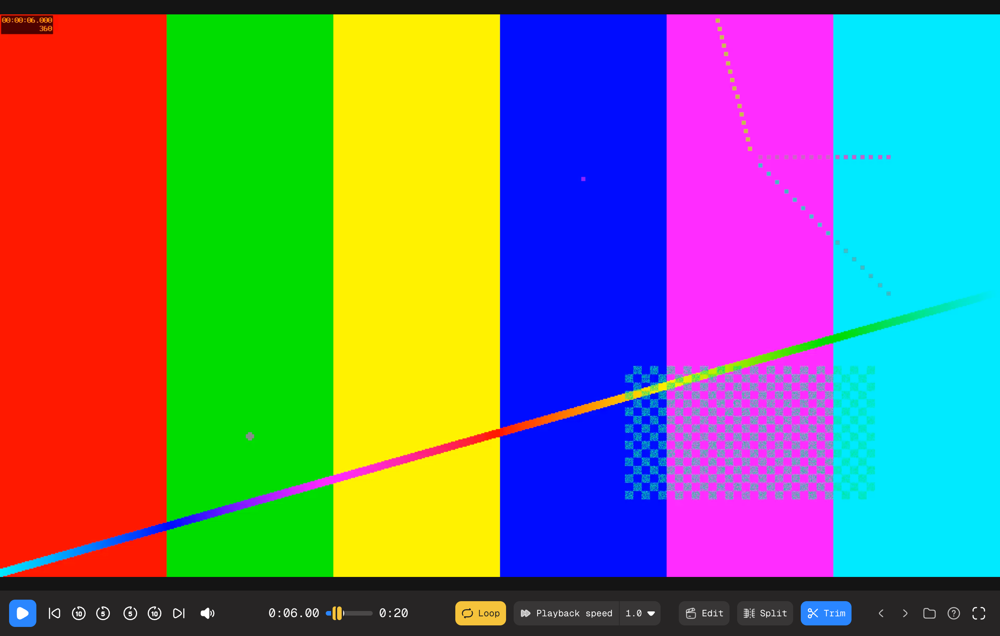

# QuickCut

A small, fast Windows video editor for clips: trim, split, speed (slow-mo or speed-up), zoom, sound effects and volume. Trims and splits keep your original quality bit for bit.

**[Download for Windows](https://github.com/NoahHendrickson/quickcut/releases/latest/download/QuickCut-Setup.exe)** (Windows 10/11, 64-bit)



## Two modes

The file name and its details are in the window's title bar, so the video fills the window. One frosted bar of controls floats over it and slides away after a moment without mouse movement (like an auto-hiding Dock): play, frame steps, ±5 / ±10 s, volume, the seek bar, **Loop** (turns yellow, then drag its two yellow ends on the seek bar), playback speed, **Edit**, **Trim** and full screen (or press F, or double-click the video).

- **Watch**: a clean player for investigating clips. Step frame by frame (hold ← → to keep going), play at any speed from 0.1× to 16×, loop an A–B section, and scroll on the video to zoom into the picture. **Trim** right from the player: drag the two handles on the seek bar, play the selection to check it, and save. It's lossless by default, with an optional exact start.
- **Split** (or press P): turn one video into several. Choose a number of equal parts, or a length per part (`2h`, `30m`, `1:30:00`; the last part gets what's left). The dialog lists every part, then saves them as new videos next to the original, losslessly.
- **Edit**: one row per effect: Trim, Amplitude, Zoom, Speed, Freeze (hold a frame for a few seconds, then carry on; press H) and Sounds. Each row shows its controls on the left (exact times, amounts, the zoom centre in pixels…) lined up with its lane on the timeline, where you can also drag things directly. Switching from Watch with a loop set starts your trim on that loop.

## Install

1. Run `QuickCut-Setup.exe`. It installs for your user only (no admin prompt).
2. Windows SmartScreen may say "Windows protected your PC" because the app isn't code-signed with a paid certificate: click **More info → Run anyway**.
3. On first launch QuickCut downloads its video engine (ffmpeg, 78 MB, checksum-verified) once.

QuickCut checks for updates when it starts. When there's a new version, an **Update** button appears in the player bar: one click downloads, installs and restarts. Updates are signed; the app refuses any update not signed with the project's key.

## Quality

| Edit | What happens | Quality |
|---|---|---|
| Trim / split | Video and audio stream-copied | Bit-for-bit identical |
| Sound effects / volume | Video copied, audio remixed | Video untouched |
| Speed change (slow-mo or speed-up) / zoom / freeze frame / exact start | Re-encoded on your GPU (NVIDIA/AMD/Intel) or CPU | Visually lossless; 10-bit/HDR stays 10-bit |

## Development

Tauri 2 (Rust) + plain HTML/JS UI, driving ffmpeg.

- `src/ffargs.js`: all ffmpeg command building (pure, unit-tested)
- `src/app.js`, `src/index.html`, `src/style.css`: the UI
- `src-tauri/src/main.rs`: commands (probe, keyframes, thumbnails, waveform, export runner, ffmpeg setup, updates)
- `src-tauri/src/server.rs`: localhost range-request server that streams big videos to the preview

```sh
npm install
npm test                      # ffmpeg end-to-end tests (incl. A/V sync, lossless splits, zoom) + Rust tests
npm run test:ui               # every UI flow in headless Chrome (needs Google Chrome installed)
node test/run-ui.mjs flow     # just one of them: test/ui-flow.mjs
```

The UI scripts (`test/ui-*.mjs`) share `test/harness.mjs`: the real frontend with a mock Tauri bridge that runs real ffmpeg, served under the app's Content-Security-Policy (from `tauri.conf.json`). A script fails if a step times out, a `check` fails, or the page logs an error, which includes anything the policy blocks. They write their screenshots to `/tmp/qc-demo/shots`.

### Building on macOS for Windows

```sh
brew install llvm lld nsis
cargo install --locked cargo-xwin
rustup target add x86_64-pc-windows-msvc
```

### Releasing an update

```sh
node scripts/release.mjs 1.1.0 "What changed"
```

This bumps the version, runs the tests, builds and signs the installer, and publishes a GitHub release with `latest.json`, which installed apps check for updates.

The update signing key lives at `~/.tauri/quickcut.key` and must never be committed. **Back it up**: without it, installed copies can't verify new updates and would need a manual reinstall.

## Licenses

QuickCut downloads a GPL build of [FFmpeg](https://ffmpeg.org) ([BtbN/FFmpeg-Builds](https://github.com/BtbN/FFmpeg-Builds), source: [FFmpeg release/8.1](https://github.com/FFmpeg/FFmpeg/tree/release/8.1)). Inter and Geist Mono fonts: SIL Open Font License (`src/fonts/LICENSE.txt`, `src/fonts/LICENSE-GeistMono.txt`). Icons: [Hugeicons](https://hugeicons.com) free set (MIT).
